# Reckon Native

Your NZ bank accounts, balances, and recent activity on your Mac.
Reckon connects to Akahu and runs as a standalone app. You do not need a terminal or a separate server.

**[Download the latest release](https://github.com/deracs/reckon-native/releases/latest)**

## Desktop app

Reckon includes a full desktop window alongside the menu-bar dropdown.

The desktop uses a light canvas, soft blue navigation, bank shortcuts, an integrated balance forecast, and a searchable transaction table with account filters and transaction details. Accounts also supports manually entered balances and savings goals; Overview shows net worth by currency. Bank and account filters show the bank name and logo; the account menu groups accounts under each bank. Select a bank in the sidebar to see its accounts and recent activity together. The activity list is filtered from the latest 100 non-transfer transactions across all connected accounts, within six months. All six sections use the same data and unlock session as the dropdown.

Bills shows upcoming estimates and recurring payments with bank logos, account names, and currencies. Spending offers bar and pie charts and an inclusive From/To date selector in the desktop window. The app saves your chart choice. The pie chart includes all categories, with smaller categories in **Other categories**.

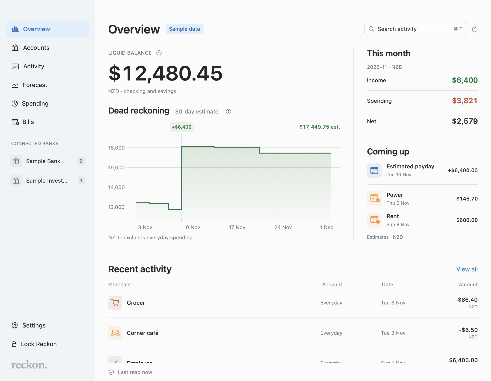

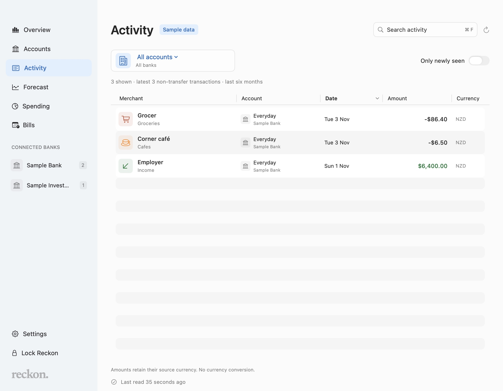

Open the desktop from **Open app** in the dropdown or **Window → Open Reckon**. Opening Reckon from the Dock also restores its window. Closing or minimizing it leaves the menu-bar dropdown available. Window size and position are saved.

The desktop opens locked at launch. To start with only the menu-bar icon, disable **Settings → General → Open desktop window at launch**. **Launch at login** remains a separate option.

| Shortcut | Action |
| --- | --- |
| **⌘0** | Open or restore the desktop window. |
| **⌘1–9** | Open a connected bank’s accounts, in sidebar order. |
| **⌘⌥1–6** | Open Overview, Accounts, Activity, Forecast, Spending, or Bills. |
| **⌘F** | Focus activity search. |
| **⌘,** | Open Settings during an unlocked session. |
| **⌘W / ⌘M** | Close or minimize the active window. |

The desktop requires the same macOS authentication as the dropdown. Locking either surface clears desktop searches and selections and hides all bank content. Desktop demo previews use fictional data and skip authentication.

The [design reference](docs/design/README.md) records the approved visual direction. The screenshots above show the implemented app.

## Screenshots

These app previews show fictional demo data. Demo mode does not read saved credentials or bank history.

| Overview | Accounts | Forecast |
| --- | --- | --- |
| <a href="docs/screenshots/overview-demo.jpg">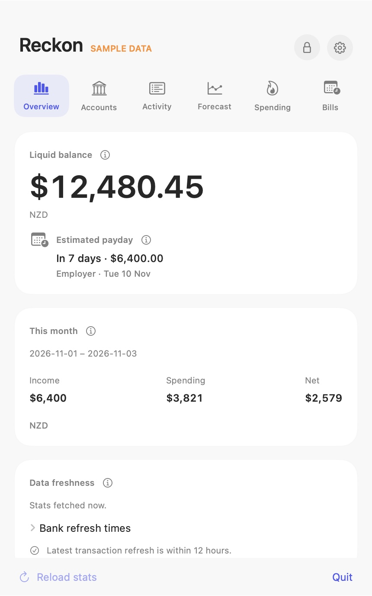</a> | <a href="docs/screenshots/accounts-demo.jpg">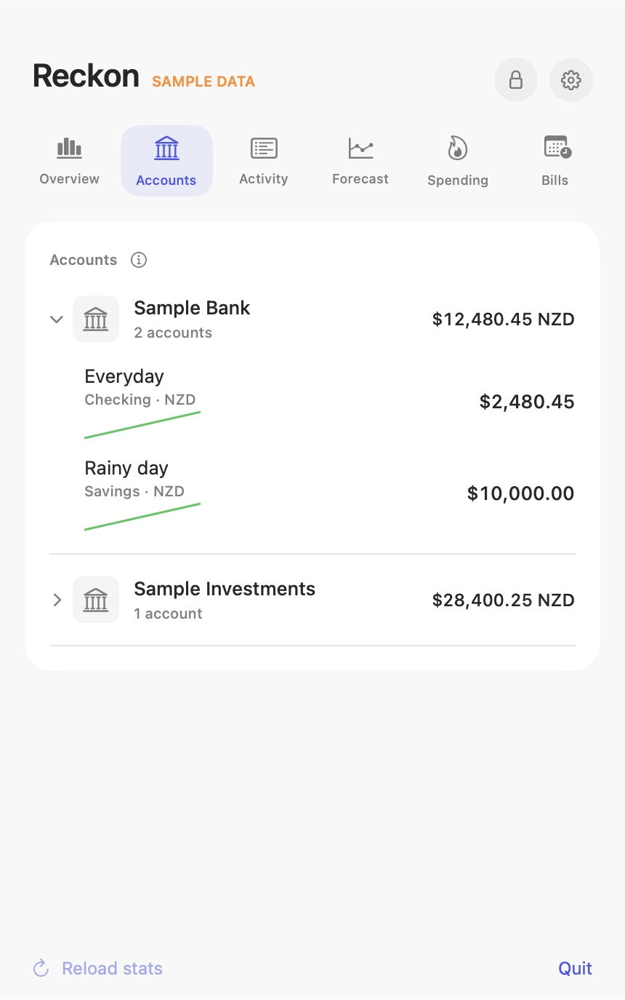</a> | <a href="docs/screenshots/dead-reckoning-demo.jpg">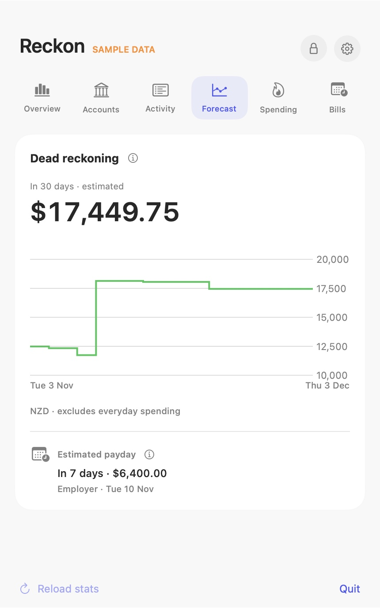</a> |

| Desktop Bills | Spending: bar | Spending: pie |
| --- | --- | --- |
| <a href="docs/screenshots/desktop-bills-demo.jpg">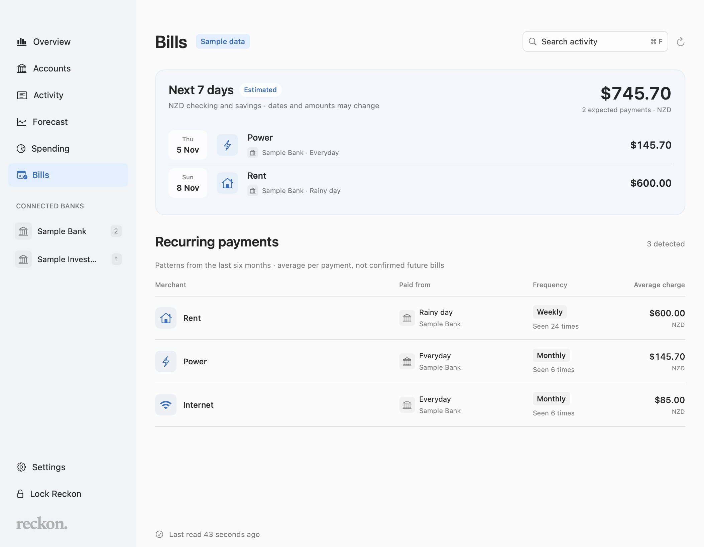</a> | <a href="docs/screenshots/desktop-spending-bar-demo.jpg">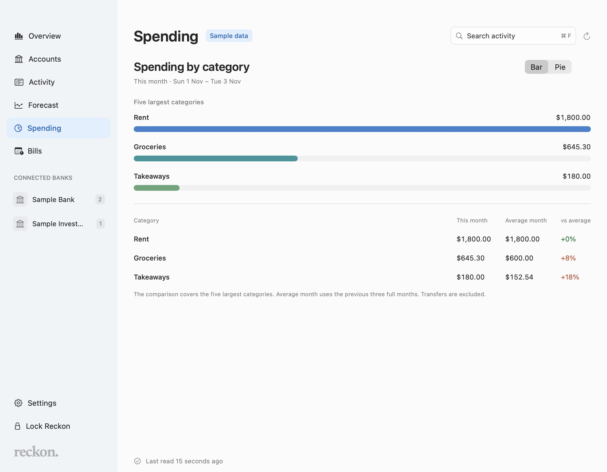</a> | <a href="docs/screenshots/desktop-spending-pie-demo.jpg">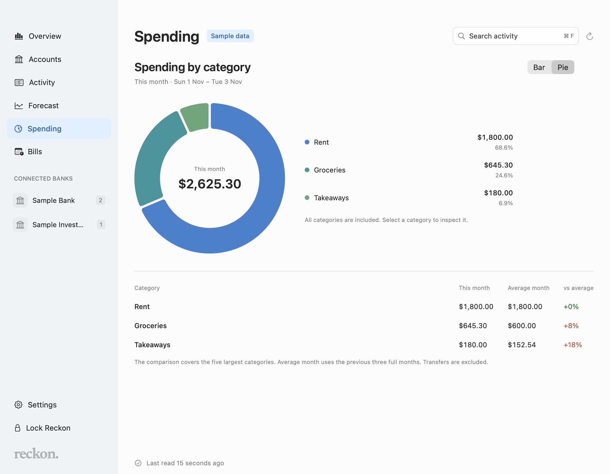</a> |

Click a screenshot to view it at full size.

## What you need

- **macOS 15 or later.** Apple silicon and Intel Macs are supported.
- **A Mac login password.** Reckon accepts Touch ID, Apple Watch, or your Mac login password through the macOS authentication prompt.
- **An Akahu personal app** with access to your accounts. You need its App ID token and User Access token.

## Install Reckon

1. Open the [latest release](https://github.com/deracs/reckon-native/releases/latest).
2. Under **Assets**, download the ZIP for your Mac:
   - **Apple silicon** (M1 or later): choose the file that ends in `arm64.zip`.
   - **Intel**: choose the file that ends in `x86_64.zip`.
3. Open the ZIP file.
4. Drag **Reckon.app** into **Applications**.
5. Open Reckon from Applications.

To check your Mac type, open **Apple menu → About This Mac**. Look for **Chip** or **Processor**.

This personal build has no Apple Developer ID signature or notarization.
If macOS blocks the first launch, review the app in **System Settings → Privacy & Security**.
A work-managed Mac can block the app entirely.

## Connect your accounts

For your first Akahu connection, use [Akahu’s personal app guide](https://developers.akahu.nz/docs/personal-apps).

1. Open the [**Developers** page in Akahu](https://my.akahu.nz/developers).
2. Get the **App ID token** and **User Access token** for your Akahu personal app.
3. Click the **chart icon** in the macOS menu bar.
4. Unlock Reckon with Touch ID, Apple Watch, or your Mac login password.
5. Click **Connect Akahu**.
6. Enter each token in its named field.
7. Click **Save and connect**.

Reckon saves the tokens in your Mac’s Keychain. Later launches use the saved connection.
Reckon reads account data. It cannot move money or make payments.

## Find your way around

The dashboard has six labeled tabs and separate cards for each group of figures.
Hover over a tab for its full section name. Hover over a small **info icon** for an explanation, or click it.

| Tab | What it shows |
| --- | --- |
| **Overview** | Liquid balance, this month’s income and spending, estimated payday, and data freshness. |
| **Accounts** | Accounts grouped by bank, with bank logos and totals for each currency. Click the whole bank row to expand it. |
| **Activity** | Recent transactions, search, and a filter for transactions first seen since your previous visit. |
| **Forecast** | **Dead reckoning:** a 30-day balance estimate from regular income and bills, with an optional everyday spending allowance, editable recurring amounts and dates, and manually added recurring income or bills. |
| **Spending** | **The bleed:** current-month categories, with desktop bar/pie choices and a comparison of the five largest categories against the previous three months’ average. |
| **Bills** | **Standing orders:** detected regular charges and estimated bills due in the next seven days. Desktop rows identify each source bank and account. |

The menu bar shows only the chart icon. Your balances appear inside the dropdown after you unlock it.

## Settings

The Settings window has four sections in its sidebar. Its title bar retains the standard Mac window controls.

| Section | Controls and details |
| --- | --- |
| **General** | Launch at login, opening the desktop at launch, the keyboard shortcut, and local history status. |
| **Connection** | Akahu connection status and token fields. Token changes require an explicit save. Disconnect requires confirmation. |
| **Alerts** | Notifications, balance limits, balance targets, and deposit alerts. Bank names and icons separate the account rows. |
| **Updates** | Installed and latest versions, last check time, check result, and automatic update options. |

| Connection | Alerts by bank | Updates |
| --- | --- | --- |
| <a href="docs/screenshots/settings-connection-demo.jpg">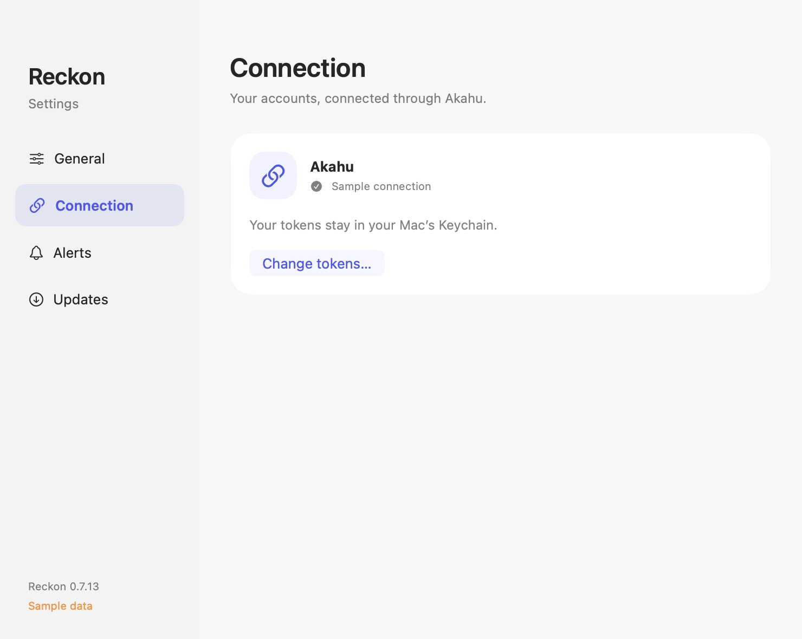</a> | <a href="docs/screenshots/settings-alerts-demo.jpg">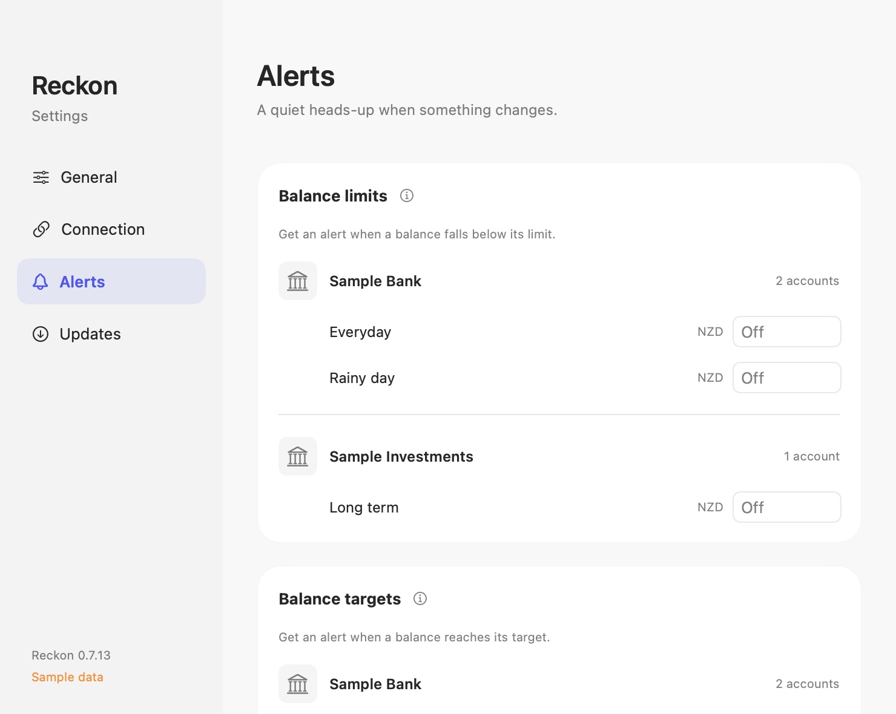</a> | <a href="docs/screenshots/settings-updates-demo.jpg">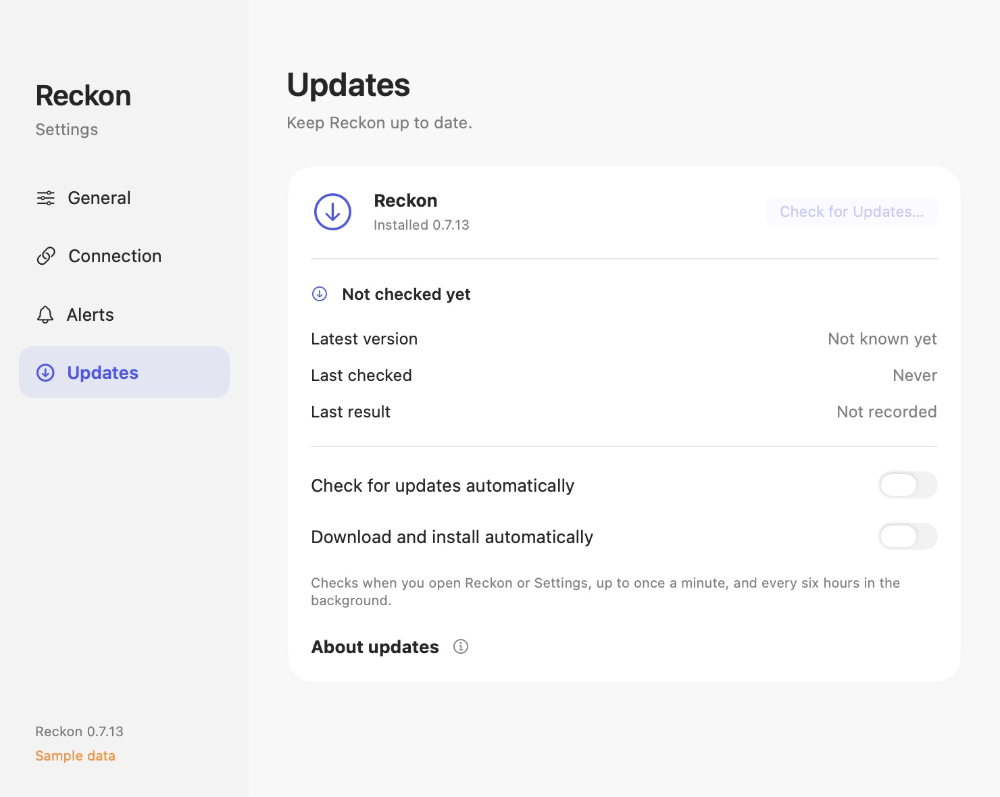</a> |

Demo mode disables connection changes, notifications, and update checks. Click a preview to view it at full size.

## Everyday use

- **Open from any app:** press **Control–Option–R**. Change the shortcut option in **Settings → General**.
- **Open Settings:** click the **gear icon** in the dropdown.
- **Start with your Mac:** enable **Launch at login** in **Settings → General**. Keep Reckon in Applications.
- **Read the latest data:** click **Reload stats**. Reckon also reads data every five minutes.
- **Enable alerts:** open **Settings → Alerts**. Alerts are off by default. Notification banners hide account names and amounts.
- **Lock immediately:** click the **lock icon**. Reckon otherwise locks ten minutes after you unlock it.

Sleep or a macOS session switch also locks Reckon. The app can continue to read data while its interface is locked.

### Unlock Reckon

Click **Unlock Reckon** on the lock screen. macOS controls which authentication methods appear in its prompt.

- **Touch ID:** use a fingerprint that you registered on your Mac.
- **Mac login password:** choose the password option in the macOS prompt. Touch ID is optional.
- **Apple Watch:** enable your watch in **System Settings → Touch ID & Password** (or **Login Password**). Wear your unlocked watch near your Mac. Double-click its side button when macOS requests approval.

Apple Watch requires a compatible Mac, Wi-Fi, Bluetooth, and the same Apple Account with two-factor authentication on both devices.
Your watch also needs a passcode. See [Apple’s setup requirements](https://support.apple.com/en-us/102442).

macOS checks your Mac login password. Reckon does not receive or store it. Each method starts the same ten-minute unlocked session.

## Updates

Reckon quietly checks GitHub when you open the dashboard or Settings, at most once a minute, and every six hours in the background. Automatic downloads and installation are on by default.
Updates install when Reckon quits, or you can choose to install and relaunch immediately.

For a manual check, open **Settings → Updates → Check for Updates**.
The dashboard shows a spinner while checking and an update icon only when an update is available or ready to install. Click the icon to open the update window; hover to see the version and status.
Settings shows the installed and latest versions, last check time, and result. Turning off automatic checks also disables checks on opening; manual checks remain available.
Updates keep your saved connection, local history, and login preference. Authentication still applies after the app restarts.

For version 0.7.1 or earlier, install the latest release manually once. Later updates use the current update feed.

## Your data

- Akahu tokens stay in **macOS Keychain**.
- Balance history stays **encrypted on this Mac**, with up to 90 daily observations per account.
- Manual accounts, savings goals, and forecast assumptions are separately encrypted on this Mac and retained when you disconnect Akahu.
- Update checks send **no bank data or Akahu tokens** to GitHub. GitHub receives normal connection metadata, such as your IP address.
- The public source and release downloads contain **no saved bank connection or personal bank history**.

**Disconnect…** in Settings → Connection asks for confirmation, then removes the saved tokens and resets local history and alert settings.

## A few things to know

**Liquid balance** includes NZD checking and savings accounts only. Investments and foreign currencies do not contribute to that number.

**Currencies stay separate in Accounts.** Some income and spending totals combine currencies without conversion. Reckon labels those totals as mixed currencies.

**Dead reckoning and payday dates are estimates.** Enter an everyday spending allowance in Forecast; it defaults to zero. Detected bills and deposits can change. Change individual estimated dates or add a recurring item in the desktop Forecast view; these changes do not alter bank payments. The low point covers combined liquid NZD accounts, not each account separately.

**Manual balances do not refresh automatically.** Update them in Accounts. Net worth includes only connected and entered accounts; it keeps currencies separate and treats manual debts as amounts owed. Savings goals assume the linked account balance is available for that goal.

**Spending defaults to this month.** Choose From and To dates in the desktop Spending view to inspect another period. Activity includes the latest 100 transactions from six months. Older transactions can have categories while current-month transactions remain uncategorized. Reckon uses Akahu categories, without the web app’s saved category rules or overrides.

## Common questions

### Why does Keychain ask for access again?

Reckon reads two protected items: your Akahu connection and the key for local history.
The current app signature changes between releases, so macOS can ask for permission again after an update.
This prompt is separate from the ten-minute unlocked session. API requests reuse the credentials already in memory.

### Why can I not unlock Reckon?

Use your Mac login password in the macOS authentication prompt if Touch ID is unavailable or locked. Reckon does not require Touch ID.

If Apple Watch approval is unavailable, check the [unlock setup](#unlock-reckon) or use your Mac login password.

### Why do bank figures look old?

Check **Bank refresh times** in Overview. Akahu’s source refresh time can differ from Reckon’s latest data read.

### Does this use my Reckon web app settings?

Reckon Native reads Akahu directly. It does not use the web app’s database, category overrides, or category rules.

## For developers

See the [developer guide](docs/DEVELOPMENT.md) for source builds, demo mode, checks, backend details, and release instructions.
See the [publication audit](docs/PUBLICATION-AUDIT.md) for the privacy checks and their limits.
